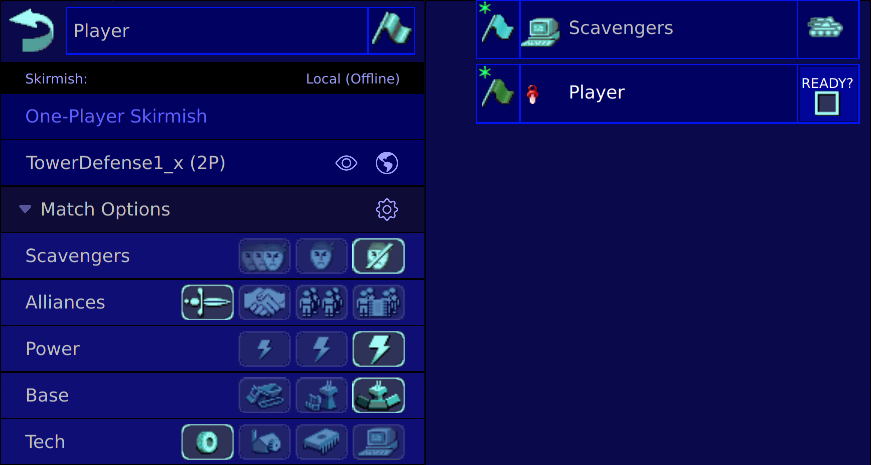

# Tower Defense Mod
- Protect your command center!
- Scavengers spawn on the edges of the map
- Earn power by destroying scavengers
- The power level (Low/Medium/High) controls how much power is earned
- VTOL factories are disabled
- The mod works on any map, with any number of players

## Download
1. Start Warzone 2100. Click **Options**
2. Click "Open Configuration Directory"
3. Download [`📦2c-TowerDefense1_x.wz`](https://github.com/aco4/WZmodTowerDefense/raw/refs/heads/main/map/2c-TowerDefense1_x.wz). Put in `📁maps/`
4. Download [`📦WZmodTowerDefense.zip`](https://github.com/aco4/WZmodTowerDefense/releases/latest). Put in `📁mods/4.7.0/autoload/`
5. Restart Warzone 2100

## Recommended Game Settings

## Configuration
Edit `📄config.js` to configure:
- time between rounds
- scavenger unit designs
- etc.

Tips:
- To double the amount of scavengers, use a text editor to replace "`spawn(`" with "`spawn(2*`"
- To halve the amount of scavengers, use a text editor to replace "`spawn(`" with "`spawn(0.5*`"
- To double the amount of scavenger vipers, use a text editor to replace "`,vipers`" with "`*2,vipers`"
- Read `multiplay/script/mods/configAPI.js` for documentation

## License
SPDX-License-Identifier: GPL-2.0-or-later

This program is free software; you can redistribute it and/or modify
it under the terms of the GNU General Public License as published by
the Free Software Foundation; either version 2 of the License, or
(at your option) any later version.

This program is distributed in the hope that it will be useful,
but WITHOUT ANY WARRANTY; without even the implied warranty of
MERCHANTABILITY or FITNESS FOR A PARTICULAR PURPOSE.  See the
GNU General Public License for more details.

You should have received a copy of the GNU General Public License along
with this program; if not, see https://www.gnu.org/licenses/.
